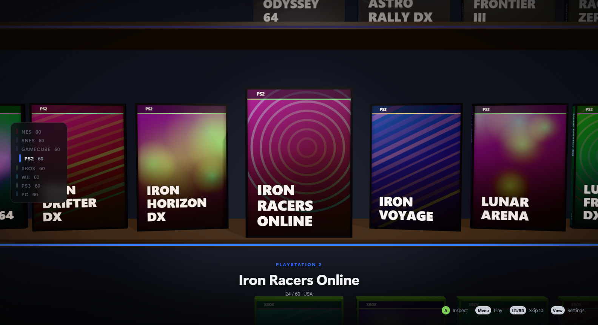

# MegaShelf

A 3D shelf for your games. Every console is a shelf, every game is a box you
can pick up and turn over, and pressing A starts it in the right emulator or
store launcher.



## Run it

```bash
npm install
```

```bash
npm run demo
```

`npm run demo` fills the shelves with generated titles so you can try it with
no setup. `npm start` runs full-screen against your real library, and
`npm run dev` does the same in a window. `npm test` runs the unit tests.

To build the Windows installer into `dist/`:

```bash
npm run dist
```

## Set up your library

Press **View** on the controller (or **F1**) to open Settings.

- **Emulators:** common install locations are detected. Use *Locate* for the rest.
- **ROM folders:** add one or more folders per system. Subfolders are scanned.
- **PC games:** Steam, Epic, the Xbox app and Battle.net are detected automatically.
- **Box art:** fronts are fetched by ROM file name (libretro thumbnails) and
  Steam app id. To supply your own, put `<rom name>-front.png`,
  `-back.png` and `-spine.png` next to the ROM. Missing faces are generated.

RetroArch needs its cores installed (`mesen` for NES, `snes9x` for SNES) from
its Online Updater. Change cores, or add per-emulator `extraArgs`, in
`config.json` in the app's user data folder (`%APPDATA%\megashelf` on Windows).

## Controls

| Xbox controller | Keyboard | Shelf | Inspecting a box |
|---|---|---|---|
| D-pad / left stick | Arrow keys | Move game, change shelf | Rotate |
| Right stick | | | Rotate |
| A | Enter | Inspect | Play |
| B | Esc | | Back |
| X / Y | X / Y | | Flip to back / show spine |
| LB / RB | PageUp / PageDown | Jump 10 games | |
| LT / RT | - / = | | Zoom |
| Menu | P | Play | Play |
| View | F1 | Settings | |

MegaShelf detects which input you are using and relabels the on-screen hints
to match: Xbox, PlayStation (✕ ○ □ △, L1/R1) or Nintendo button names,
keyboard keys, or mouse gestures. It switches the moment you touch a different
device, and hides the cursor while you use a controller. On Nintendo pads A
confirms and B goes back.

Mouse: click a box to select it, click again to inspect, drag to rotate, wheel
to scroll or zoom. **F11** toggles full screen. **Ctrl+Alt+Backspace**
force-closes a running emulator.

## Supported systems

NES and SNES (RetroArch), GameCube and Wii (Dolphin), PS2 (PCSX2), PS3
(RPCS3), Xbox (xemu), and PC (Steam, Epic, Xbox app, Battle.net).

To add a system, add an entry to `src/main/systems.js` and, if it needs a new
box shape, a profile in `src/renderer/engine/BoxFactory.js`.

## How it works

See [docs/ARCHITECTURE.md](docs/ARCHITECTURE.md), including what has and has
not been tested.
